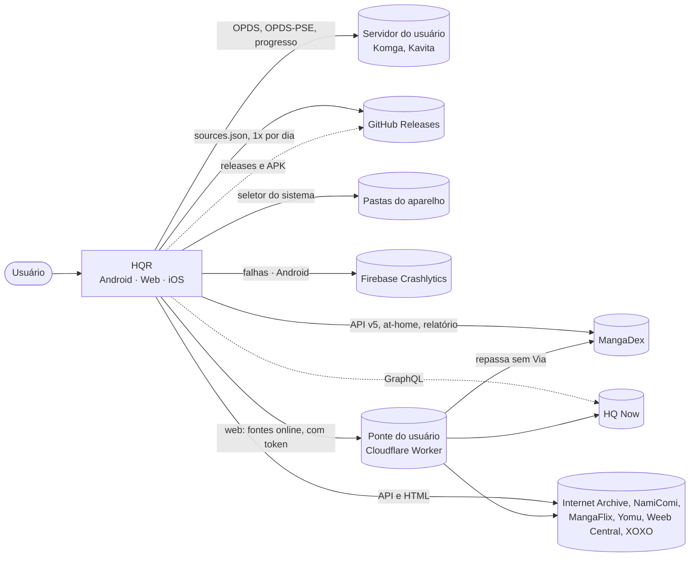
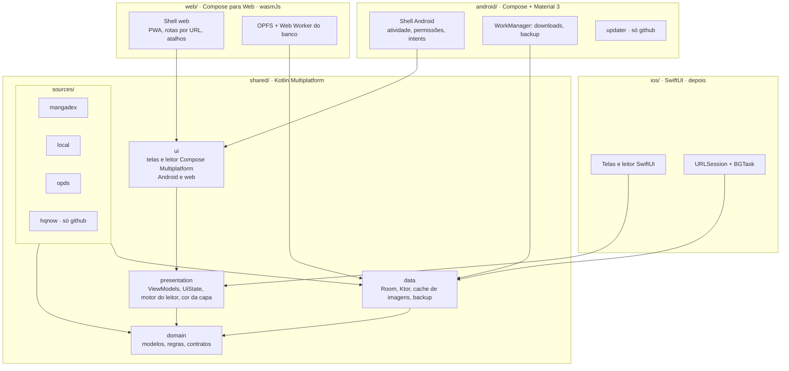
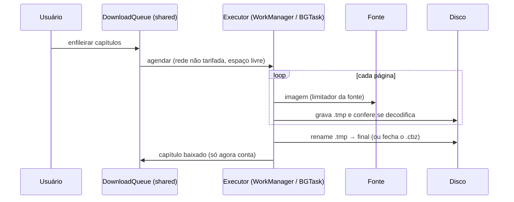
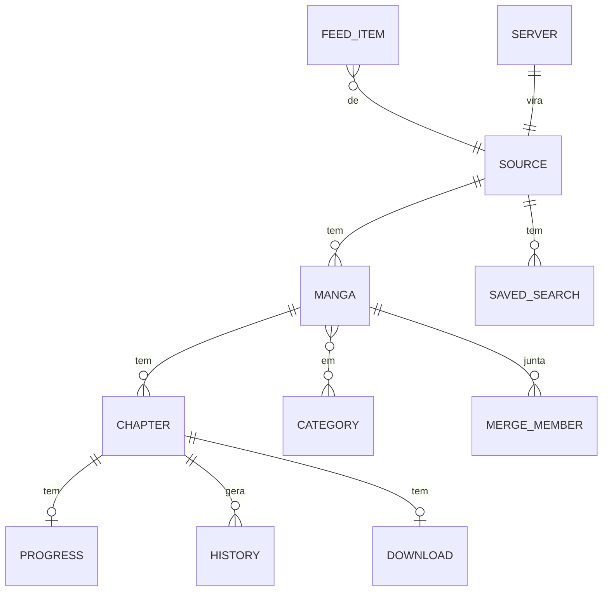

# Arquitetura: HQR

> Versão 1.0 · 2026-10-29 · Entrada: `docs/srs.md`, `docs/use-cases.md` · Estilo: arc42 enxuto, C4 em Mermaid, decisões em §10

## 1. Metas de qualidade

| Prioridade | Meta | Requisitos |
| :-- | :-- | :-- |
| 1 | Leitura fluida: página na hora, sem travar, sem estourar a memória | RNF-02 a RNF-04, RNF-23 |
| 2 | Dados do usuário nunca se perdem (falha de fonte, processo morto, restauração) | RNF-17, RNF-18, RNF-25, RF-88, RF-89 |
| 3 | Fontes isoladas: uma quebra sem derrubar as outras; fontes de terceiros removíveis sem refazer o app | RNF-16, RNF-24, C-03 |
| 4 | Um núcleo para Android, web e iOS; telas Compose iguais no Android e na web | RNF-15, C-05, RF-107 |
| 5 | Seguro com arquivos e servidores do usuário | RNF-09, RNF-26, RF-95 |

Restrições: C-01 a C-12 do SRS.

## 2. Contexto (C4 nível 1)



| Parceiro | O que trocamos |
| :-- | :-- |
| MangaDex | Pedimos listas, obra, capítulos, servidor de imagens; enviamos o relatório at-home; User-Agent próprio |
| HQ Now | Pedimos populares, recentes, busca, obra, páginas (GraphQL) |
| Servidor do usuário | Catálogo OPDS, páginas por streaming; credencial do usuário; progresso (Komga/Kavita) |
| Pastas | Lemos arquivos locais; escrevemos só downloads e backups em pastas escolhidas |
| GitHub Releases | Lemos a última versão e baixamos o APK |
| Crashlytics | Rastro da falha, aparelho, id de instalação; desligável |
| Ponte do usuário | Só na web: recebe os pedidos das fontes online com o token e os repassa (API e imagens); publicada pelo próprio usuário (ADR-023) |

## 3. Containers e módulos (C4 nível 2)



Regra: `domain` não conhece rede, banco nem plataforma. O que muda por plataforma entra por interface: `FileTree` (pastas), `ArchiveReader`, `PdfPages`, `SecretStore`, `DownloadScheduler`, `Clock`. Cada fonte é um módulo Gradle que depende de `domain` e do kit de rede de `data`; `data` nunca depende de uma fonte: as fontes entram pelo registro `SourceRegistry` (interface em `domain`), montado pelo Koin do sabor (ADR-003, ADR-013). Sem ciclo entre módulos. Convenções em `build-logic/`, scripts em `scripts/`.

| Componente | Módulo | Faz | Requisitos |
| :-- | :-- | :-- | :-- |
| `source` | domain | Contrato `Source` (catálogo, busca e filtros, obra, capítulos, páginas), `SourceId` constante, versão de esquema, registro de fontes | RF-01, RF-90, RF-91 |
| `net` | data | Cliente Ktor, limitador por fonte, política de tentativas, User-Agent, regras de cleartext | RF-04, RNF-24, RNF-09 |
| `images` | data | Busca de páginas e capas, cache em disco LRU, pré-carregamento | RF-41, RNF-23 |
| `library` | domain + data | Obras, capítulos, categorias, progresso, histórico, junções, buscas salvas, feed | RF-52 a RF-61, RF-24, RF-25, RF-71 |
| `reader` | domain + presentation | Motor do leitor: lista de páginas, modo, zonas, pré-carga, transição, gravação de progresso, quadro a quadro, cor da capa | RF-36 a RF-51, RF-97, RF-98 |
| `download` | domain + data | Fila, estados, gravação atômica, CBZ; executor por plataforma | RF-62 a RF-68, RNF-21, RNF-25 |
| `browse` | domain + presentation | Explorar, busca global com isolamento por fonte, feed, obra e capítulos, estados de tela | RF-05, RF-21 a RF-35, RF-86, RF-87, RF-92 |
| `app` | android / ios | Ajustes, Sobre, primeira abertura, "Abrir com", permissões, restauração de estado | RF-78 a RF-81, RF-85, RF-88, RF-93, RF-94 |
| `migration` | domain | Candidatos, transferência de progresso, junção | RF-69 a RF-71 |
| `backup` | data | Exportar, validar, unir, backup automático | RF-72 a RF-75, RF-89 |
| `settings` | data | Preferências (DataStore), idiomas, tema, fontes ligadas | RF-03, RF-06, RF-76, RF-77 |
| `sources/mangadex` | sources | API v5, at-home, relatório, créditos, classificação de conteúdo | RF-07 a RF-11 |
| `sources/local` | sources | Pastas, CBZ, CBR (Android), PDF, ComicInfo | RF-13 a RF-16 |
| `sources/opds` | sources | OPDS 1.2, OpenSearch, PSE, progresso Komga/Kavita, certificado fixado | RF-17 a RF-20, RF-95, RF-96 |
| `sources/hqnow` | sources | GraphQL do HQ Now | RF-12 |
| `sources/archive`, `namicomi`, `mangaflix`, `yomu`, `weebcentral`, `xoxo` | sources | Fontes adicionais, cada uma com o seu limite de pedidos | RF-99 a RF-104 |
| `sourceconfig` | data | Lê `sources.json` 1x por dia, guarda a última versão, aplica ligar/desligar e endereço | RF-105 |
| `challenge` | android / ios | Navegador embutido para a verificação do Cloudflare e cookies compartilhados com o Ktor | RF-106 |
| `updater` | android (github) | Releases, download, verificação, instalador | RF-82 |
| `ui` | shared (Android e web) | Telas, componentes, tema (violeta base) e leitor em Compose Multiplatform | RNF-11, RNF-12, RF-107 |
| `contentcolor` | presentation | Extrai a cor da capa (MaterialKolor), aplica a regra do erro, monta o esquema claro e escuro e guarda por obra | RF-98 |
| `web` | web | PWA, rotas por URL, importação para o OPFS, cota, atalhos, avisos do que não roda no navegador | RF-107, RF-110 a RF-114 |
| `bridge` | data | Na web, reescreve os pedidos das fontes online para a ponte com o token; testa a ponte | RF-108 |
| `bridge-worker/` | fora do app | Código da ponte (Cloudflare Worker) e passo a passo para o usuário publicar | RF-109 |

### 3.1 App iOS (depois)

Mesmo desenho do Script Reader: `ios/HQR.xcodeproj` com pastas sincronizadas, framework `Shared` de `shared/presentation`, ponte `Screen<T>`/`ScreenModel` sem SKIE, uma pasta por área em `Features/`, prévias claras e escuras. O leitor usa o motor de `presentation` e desenha com SwiftUI e ImageIO. CBR e CB7 ficam fora no iOS (ADR-011). A cor da capa vem pronta de `contentcolor` e entra como tint do SwiftUI.

### 3.2 App web (marco Web)

`web/` é um alvo `wasmJs` que usa o mesmo `ui` do Android (ADR-022). Diferenças por interface: `FileTree` sobre o OPFS (importação por seletor ou arrastar e soltar), `PdfPages` pelo pdf.js, `ArchiveReader` só ZIP/CBZ (CBR e CB7 recusados com o motivo), `SecretStore` no armazenamento do navegador, Downloads só no app do celular por enquanto (mostrados com o motivo, RF-114), e o `bridge` na frente das fontes online (ADR-023). Fontes com verificação do Cloudflare (`challenge`), `updater` e Crashlytics não existem na web. Rotas da navegação viram o endereço do navegador (RF-113).

## 4. Execução

### 4.1 Abrir e ler um capítulo do MangaDex (UC-004)

```mermaid
sequenceDiagram
  participant R as ReaderViewModel
  participant S as MangaDexSource
  participant L as Limitador MangaDex
  participant I as images (cache)
  participant DB as library.db
  R->>DB: progresso do capítulo
  R->>S: pageList(capítulo)
  S->>L: aguarda vaga (5/s; at-home 40/min)
  S-->>R: servidor at-home + nomes das páginas
  R->>I: página N (e N+1..N+4)
  alt no cache ou baixado
    I-->>R: bytes do disco
  else
    I->>L: aguarda vaga
    I-->>R: bytes da rede (relatório at-home em segundo plano)
  end
  R->>DB: página atual (500 ms depois da troca)
  Note over R,S: 12 min de uso ou 403 → pede outro servidor at-home
```

### 4.2 Baixar capítulos (UC-007)



### 4.3 Restaurar backup (UC-011)

Lê o arquivo (≤ 200 MB), valida esquema e versão, e numa transação une cada obra pela chave `(sourceId, chave da fonte)`: lidos e categorias pela união, progresso pelo maior, ajustes locais mantidos. Obras de fonte ausente entram como "Fonte indisponível" com o nome gravado no backup.

## 5. Dados

`library.db` (Room 3, WAL; na web, driver em Web Worker com OPFS) e `settings` (DataStore; na web, armazenamento do navegador). Downloads em pasta do app ou escolhida; cache de imagens em `cacheDir/pages` (LRU).



| Tabela | Campos principais |
| :-- | :-- |
| `source` | `id` (constante no código; servidor OPDS: UUID gerado no cadastro), `kind`, `name`, `lang`, `schemaVersion`, `enabled`, `settings` (JSON) |
| `manga` | `id`, `sourceId`, `key` (único com `sourceId`), `url`, título, títulos alternativos, capa, autores, artistas, status, gêneros e tags, idioma original, sinopse, `inLibrary`, `addedAt`, `lastFetchedAt`, `coverColor` (cor-semente da capa e hash da capa usada; `null` = violeta) |
| `manga_reader_settings` | `mangaId`, modo, escala, zonas, fundo, página dupla, cortar bordas (só o que a obra muda; o resto vem do padrão global) |
| `chapter` | `id`, `mangaId`, `key`, `number` (decimal), título, idioma, grupo e `groupUrl`, `uploadedAt`, `fetchedAt` (novo até a obra ser aberta de novo), `removedAtSource`, `externalUrl` |
| `hidden_group` | `mangaId`, grupo |
| `progress` | `chapterId`, `page`, `read`, `updatedAt` |
| `history` | `chapterId`, `readAt` |
| `category`, `manga_category` | nome, ordem; associação |
| `merge`, `merge_member` | junção (título exibido); `mergeId`, `mangaId`, `priority` |
| `download` | `chapterId`, `state`, `path`, `format` |
| `saved_search`, `feed_item`, `recent_search` | fonte, termo, filtros (JSON); ordem; últimas 10 buscas |
| `server` | `sourceId`, endereço, usuário; a senha fica no `SecretStore` |

Regra de identidade (RF-90): obra = `(sourceId, key)`, capítulo = `(mangaId, key)`. `sourceId` é fixo no código de cada fonte; na local, `key` é o caminho relativo.

## 6. Privacidade e segurança

| Tema | Como |
| :-- | :-- |
| Rede | Só HTTPS; cleartext liberado na configuração do Android e bloqueado no código para hosts fora da rede local (RFC 1918, `.local`); iOS com `NSAllowsLocalNetworking` |
| Credenciais | `SecretStore`: Android Keystore e Keychain; nunca no banco, nos registros ou no backup; não seguem redirecionamento para outro host |
| Arquivos | Leitor de ZIP com proteção contra caminhos com `..`, bombas de compressão e imagens gigantes; XML sem DTD (RNF-26) |
| Dados enviados | Crashlytics no Android, desligável; nenhum analytics; iOS sem coleta |
| Conteúdo | Créditos do MangaDex e dos grupos; classificação de conteúdo aplicada na própria fonte (ADR-008) |
| Web | CSP restrita à origem, à ponte e aos servidores cadastrados; token da ponte só no navegador; ponte com allowlist de hosts, sem cache e sem registro (RNF-32) |

## 7. Distribuição

A 1.0 tem um sabor só, `github`: `com.tiagohs.hqr.reader`, fontes mangadex, hqnow, local e opds, e o `updater` com `REQUEST_INSTALL_PACKAGES`. Um sabor de loja futuro seria só `local` e `opds`, sem `updater`, ligado pelos mesmos módulos.

A web é um site estático (`web/` compilado) publicado à mão no GitHub Pages do repositório, com service worker para o PWA (C-12). A ponte não faz parte da distribuição: o usuário publica a sua a partir de `bridge-worker/`.

## 8. Qualidade

| Prática | Como |
| :-- | :-- |
| Testes | Nome com o ID; `domain` ≥ 80% e `data` ≥ 60% (Kover); fontes testadas contra respostas gravadas (fixtures), sem rede no CI |
| Telas | Roborazzi claro e escuro nos tamanhos de RNF-12; prévias obrigatórias |
| Desempenho | Macrobenchmark de abertura e de troca de página; perfil de base (baseline profile) |
| Estilo | ktlint, detekt, lint |
| CI | GitHub Actions no runner do Mac do Tiago (`[self-hosted, macOS]`, sem custo): a cada push em `rewrite/**` e à mão; APKs e web numa release rascunho, web publicada na `gh-pages` (C-08, C-12) |

## 9. Riscos

| ID | Risco | Mitigação |
| :-- | :-- | :-- |
| R-01 | DMCA no GitHub contra o repositório por causa das fontes de terceiros | Créditos, só "safe" por padrão, resposta rápida, fonte contestada desligada por `sources.json` (RF-105); risco aceito de manter um repositório só (ADR-016) |
| R-07 | Agregadores mudam de domínio ou fecham (MangaFlix, Yomu, Weeb Central, XOXO) | Endereço trocável por `sources.json`; migração entre fontes (RF-69); MangaFlix e Yomu como par redundante |
| R-02 | O leitor é o componente mais caro e existe duas vezes | Motor no `shared`; Android primeiro; Macrobenchmark desde o esqueleto |
| R-03 | Fontes mudam sem aviso | Fixtures, esquema por fonte, falha isolada |
| R-04 | Limites de segundo plano diferentes por plataforma | Fila no `shared`, executor por plataforma, paridade parcial dita no app (RNF-28) |
| R-05 | Escopo grande para um dev solo | Walking skeleton com uma fonte (local), Must primeiro; RF-69 a RF-71 e RF-75 por último |
| R-06 | Atualizador da 0.0.5 não reconhecer a release nova | Formato apurado no código (RF-84); teste num aparelho com Android 8+ antes de publicar |
| R-08 | Compose para Web ainda em Beta: APIs mudam e o desempenho de rolagem varia por navegador | Web só depois do 1.0 Android; `ui` sem API exclusiva do Android; medir RNF-30 a cada versão do Compose |
| R-09 | Room 3 em alpha desde mar/2026 [verificar] | Começar o esqueleto já no Room 3 para não migrar depois; se não estabilizar, a web guarda o banco com o driver SQLite web direto, atrás do mesmo DAO |
| R-10 | Ponte exposta: token vazado vira proxy aberto para as fontes | Token longo trocável, allowlist de hosts, limite de pedidos no Worker, sem cache; a ponte é pessoal e o projeto não divulga endereços |

## 10. Decisões (ADR)

### ADR-001 Núcleo em Kotlin Multiplatform, interface nativa
Contexto: Android agora, iOS depois, dev solo (C-05, C-09). Opções: KMP + UI nativa; Compose Multiplatform; só Android. Decisão: KMP com `domain`, `data`, `presentation` e `sources`; Compose no Android e na web (ADR-022), SwiftUI no iOS, como no Script Reader. Consequências: regras, fontes e motor do leitor uma vez só; telas duas vezes, com a qualidade nativa de cada sistema. Requisitos: RNF-15, C-05.

### ADR-002 Contrato de fonte próprio, inspirado no Mihon
Contexto: o `source-api` do Mihon é só Android (RxJava, jsoup). Decisão: contrato `Source` em `domain` com funções `suspend`, capacidades opcionais (`CatalogSource`, `SearchSource`, `ConfigurableSource`, `ProgressSyncSource`), `SourceId` constante e `schemaVersion`. Reaproveita o desenho do Mihon; código copiado mantém o aviso Apache-2.0 (C-06). Consequências: extensões do Mihon não rodam no HQR. Requisitos: RF-01, RF-90, RF-91.

### ADR-003 Fontes em módulos; um sabor na 1.0
Decisão: cada fonte é um módulo Gradle e um módulo Koin a registra; a 1.0 tem só o sabor `github`, com todas as fontes e o `updater`. Consequência: um sabor de loja, se vier, é só outra lista de módulos, e o teste de RNF-16 garante que compila sem as fontes de terceiros. Requisitos: RF-02, RNF-16, C-03.

### ADR-004 Persistência: Room 3 e DataStore
Contexto: a web precisa do mesmo banco (RF-107). Decisão: Room 3 (`androidx.room3`, só APIs `suspend` e Flow) em todas as plataformas; na web, o driver `sqlite-web` roda num Web Worker e grava no OPFS. Um banco `library.db` em WAL, migrações testadas a cada esquema; DataStore para preferências; "baixado" só depois do `rename` atômico. Opções descartadas: Room 2 KMP (sem web), SQLDelight (o Script Reader já usa Room). Consequências: Room 3 está em alpha (R-09). Requisitos: RNF-18, RNF-25, RF-88, RF-107.

### ADR-005 Rede: Ktor com limitador por fonte
Decisão: Ktor (OkHttp no Android, Darwin no iOS); cada fonte declara seu limite e todos os usos (leitor, busca, downloads, atualização) passam pelo mesmo limitador; 3 tentativas só em GET, com espera crescente; GraphQL do HQ Now por POST simples, sem Apollo. Requisitos: RF-04, RNF-24, RF-09.

### ADR-006 Imagens: busca e cache no núcleo, desenho por plataforma
Decisão: `images` no `shared` busca bytes e mantém o LRU em disco (Okio); Android decodifica com Coil 3 e mostra com zoom e decodificação por partes (biblioteca telephoto); iOS com ImageIO por amostragem. Consequências: um cache e uma regra de pré-carga; dois visualizadores. Requisitos: RNF-02 a RNF-04, RNF-23.

### ADR-007 Leitor: motor compartilhado, visual nativo
Decisão: `ReaderViewModel` em `presentation` decide páginas, modo, zonas, pré-carga, transições e progresso; o Android desenha paginado com `HorizontalPager`/`VerticalPager` e webtoon com `LazyColumn`; a transição entre capítulos é uma página própria (RF-36, RF-42). Requisitos: RF-36 a RF-51.

### ADR-008 Conteúdo e créditos aplicados na fonte
Decisão: `sources/mangadex` monta `contentRating[]` pelo sabor (loja: `safe`), inclui grupo e créditos no modelo e envia o relatório at-home. A interface não decide isso. Requisitos: RF-07, RF-08, RF-09, C-04.

### ADR-009 Downloads: fila no núcleo, executor por plataforma
Decisão: fila e estados em `download` (shared, persistidos no banco); Android executa com WorkManager como transferência iniciada pelo usuário (API 34+) ou serviço `dataSync`; iOS com `URLSession` em segundo plano e `BGProcessingTask`. O HQR lê sempre a cópia na pasta do app (uma pasta por capítulo ou um `.cbz` gravado sem compressão pelo próprio núcleo, sem biblioteca de zip); a pasta escolhida pelo usuário recebe uma cópia em `.cbz` pelo Storage Access Framework, porque ler pelo SAF a cada página seria lento e a permissão pode ser revogada. Abaixo de 200 MB livres a fila pausa com o motivo "Pouco espaço". Requisitos: RF-62 a RF-68, RNF-27, RNF-28, RF-94.

### ADR-010 Backup próprio em JSON compactado
Contexto: igual no Android e no iOS, legível e versionado. Opções: Protobuf (menor, como o `.tachibk`); JSON com gzip. Decisão: JSON (kotlinx.serialization) em gzip, extensão `.hqrbackup`, campo `schemaVersion`; sem compatibilidade com `.tachibk` na 1.0. Requisitos: RF-72 a RF-75, RF-89.

### ADR-011 Arquivos locais por capacidade de plataforma
Opções: libarchive nativo nas duas plataformas (pesado, NDK); bibliotecas JVM só no Android. Decisão: ZIP/CBZ e pastas no `shared` (Okio, acesso aleatório); PDF pelo renderizador do sistema (`PdfRenderer`, PDFKit) por interface; CBR por junrar (RAR até a v7, RAR5 incluído) e CB7 por Apache Commons Compress, só no Android, desempacotados uma vez no cache do app (os 3 últimos ficam, a capa é guardada à parte) porque não se leem por partes; EPUB fica para depois. `ComicInfo.xml` lido de CBZ e pastas; nos CBR e CB7, número e título vêm do nome do arquivo, para não desempacotar tudo só para listar. Consequências: arquivo com senha diz isso no item; iOS lê só CBZ, pastas e PDF. Requisitos: RF-13, RF-14, RNF-26.

### ADR-012 Navegação adaptativa
Decisão: `NavigationSuiteScaffold` (barra, trilho ou gaveta pela largura) com 4 destinos e lista-detalhe na obra em telas largas; Navigation Compose; no iOS, `TabView` e `NavigationSplitView`. Detalhes em `docs/ux-foundations.md`. Requisitos: RNF-12.

### ADR-013 Koin para injeção
Decisão: Koin, como no Script Reader; um módulo por sabor registra as fontes. Requisitos: C-05.

### ADR-014 Crashlytics só no Android, desligável
Decisão: Firebase Crashlytics no APK (`com.tiagohs.hqr.reader`), sem chaves personalizadas com conteúdo, desligável nos Ajustes; é também a fonte das metas de estabilidade, já que fora da Play não há Android vitals. iOS sem SDK de coleta. Requisitos: RNF-07, RNF-10, RNF-19.

### ADR-015 Atualizador próprio
Decisão: `updater` lê `releases/latest`, baixa o APK, confere o SHA-256 publicado na release e abre o `PackageInstaller`; agendado no máximo uma vez por dia. Requisitos: RF-82 a RF-84.

### ADR-017 Textos compartilhados com o iOS
Decisão: `strings.xml` do Android (pt-BR, en, es) é a fonte; um script gera o String Catalog do iOS, como no Script Reader. Consequências: tradução num lugar só; o script entra na verificação. Requisitos: RNF-14, RF-77.

### ADR-018 Estado que sobrevive ao fim do processo
Decisão: rotas da navegação e argumentos salvos pelo Navigation Compose; filtros, seleção e página do leitor em `SavedStateHandle`; a página também vai ao banco (RF-43). Consequências: teste com "Não manter atividades" em cada tela com estado. Requisitos: RF-88.

### ADR-019 Lista de fontes remota e estática
Contexto: sem servidor (C-01), mas agregadores mudam de domínio e uma fonte contestada precisa sair rápido. Decisão: `sources.json` no próprio repositório, lido pelo raw do GitHub 1x por dia, com `id`, `enabled`, `baseUrl` e versão mínima do app; última versão guardada; sem a lista, vale a embutida. Consequências: nenhuma fonte nova chega por aí, só ligar, desligar e trocar endereço. Requisitos: RF-105, R-01, R-07.

### ADR-020 Verificação do Cloudflare por navegador embutido
Decisão: WebView (Android) e WKWebView (iOS) abrem a fonte quando a resposta traz o desafio; os cookies vão para o cliente Ktor da fonte. Opções descartadas: resolver o desafio sem o usuário (frágil e contra os termos). Requisitos: RF-106.

### ADR-016 Repositório único, código antigo arquivado
Decisão: um repositório só, `tiagohs/hqr-comics-reader` (o Tiago descartou separar o núcleo); consequência: um DMCA pode tirar tudo do ar, mitigado por R-01; a 0.0.5 fica na tag `0.0.5`, que já existe e a pasta `app/` sai na reescrita; estrutura `android/`, `shared/`, `ios/`, `build-logic/`, `scripts/`, `docs/`, como o Script Reader. Requisitos: C-05, RF-84.

### ADR-021 Cor dinâmica de conteúdo
Contexto: o Tiago quer que a obra assuma as cores da capa sem sair do Material e da HIG; capas de HQ costumam ter vermelho dominante, que colide com a cor de erro. Opções: cor dominante pura; Palette do Android; algoritmo do M3. Decisão: `contentcolor` no `presentation` usa o MaterialKolor (quantização Celebi, pontuação e paleta tonal do M3, KMP) sobre a capa reduzida; pula cores a até 35° da matiz do erro (#B3261E) ou com croma abaixo de 16; sem cor válida, fica o violeta base (#5C51A8). Os papéis saem dos tons do M3 (primário 40/80, contêiner 90/30, superfícies com croma 6), o que garante o contraste. A cor-semente fica em `manga.coverColor` e só é recalculada quando a capa muda. Aplica-se só à obra, ao leitor e ao painel de detalhe; no iOS os mesmos tokens viram tint do SwiftUI. Consequências: uma obra vermelha pode ficar violeta; nenhuma tela fora da obra muda de cor. Requisitos: RF-98, RNF-11.

### ADR-022 Web com Compose para Web, telas compartilhadas com o Android
Contexto: o Tiago quer um app web de verdade, sem servidor (C-01). Opções: Compose Multiplatform para Web (wasmJs); site separado em React/TypeScript consumindo um núcleo Kotlin/JS; só PWA do layout de celular. Decisão: as telas Compose saem do `android/` para o módulo `ui` (Compose Multiplatform, alvos Android e wasmJs); `web/` é só o shell. Consequências: uma tela serve Android e web; navegadores sem WasmGC ficam de fora (RNF-31); a web depende de uma tecnologia em Beta (R-08); o iOS segue em SwiftUI. Requisitos: RF-107, RF-112, RF-113, RNF-30, RNF-31.

### ADR-023 Fontes online na web por ponte pessoal
Contexto: o MangaDex não envia CORS, exige que pedidos de navegador passem por servidor próprio, serve resposta errada para imagem em hotlink e proíbe o cabeçalho `Via` (https://api.mangadex.org/docs/2-limitations); HQ Now e os agregadores também não liberam CORS. Opções: ponte pública mantida pelo projeto (custo e risco legal, contra C-01); ponte pessoal publicada pelo usuário; web só com arquivos e servidores. Decisão: ponte pessoal num Cloudflare Worker do plano grátis, com código e passo a passo em `bridge-worker/`; o app web manda os pedidos das fontes online para ela com token; sem ponte, a web funciona com arquivos importados e servidores com CORS. Consequências: configurar a ponte exige uma conta no Cloudflare; o projeto não hospeda nem repassa conteúdo; o limite do plano grátis é do usuário. Requisitos: RF-108, RF-109, RF-111, RF-114, RNF-32.
