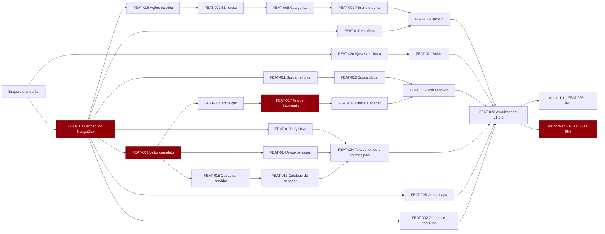

# Plano de implementação: HQR

> Estado: rascunho · Atualizado em: 2026-10-29
> Entradas: `docs/srs.md` · `docs/use-cases.md` · `docs/architecture.md` · `docs/ux-foundations.md` (todas presentes) · telas no canvas "HQR — design"

## 1. Visão geral

Reescrita do HQR em Kotlin Multiplatform com Compose no Android, para depois virar web (mesmo `ui`) e iOS (SwiftUI). O plano corta o app em 54 fatias verticais (FEAT-001 a FEAT-054) em 15 épicos alinhados aos componentes da arquitetura.

O que ordena o trabalho é **tirar risco cedo**: o motor do leitor (R-02), o MangaDex com servidor at-home e limitador (ADR-005, RF-09), o Room 3 em alpha (R-09) e o `ui` compilando também para a web (R-08) entram antes de tudo o que é largo e previsível.

| Marco | O que entra | Corte |
| :-- | :-- | :-- |
| 1.0 Android | Esqueleto + FEAT-001 a FEAT-024 | Os 60 Must; publicada como `v1.0.0` (RF-84) |
| 1.1 Android | FEAT-025 a FEAT-041 | Should, incluindo as fontes adicionais |
| Web | FEAT-050 a FEAT-054 | Requisitos da §3.1.19, depois do 1.0 |
| Depois | FEAT-042 a FEAT-049 | Could |
| iOS | FEAT-060 a FEAT-064, FEAT-068 | Começou com o OK do Tiago às telas do Android (C-09); mesmo núcleo, telas em SwiftUI |

Dev solo (C-10), sem custo (C-01, C-08). As fases além da próxima são uma ordem viva, não um compromisso de datas.

## 2. Esqueleto andante

O caminho mais curto que atravessa todos os módulos e prova que o app compila, roda e instala. A fonte do esqueleto é a local (R-05): não depende de rede nem de site de terceiros.

| | |
| :-- | :-- |
| Fluxo | Abrir o app → Biblioteca vazia → escolher uma pasta → as subpastas e os CBZ viram obras na Biblioteca (gravadas no banco) → tocar numa obra abre a tela da obra com o título e a primeira página como capa |
| Real | Estrutura `android/`, `shared/` (`domain`, `data`, `presentation`, `ui`), `sources/local`, `build-logic/`; contrato `Source` mínimo com `SourceId` constante; Room 3 com `library.db` (tabelas `source`, `manga`); Koin; `NavigationSuiteScaffold` com os 4 destinos; tema violeta gerado de `tokens.json`; Roboto Flex e Bangers; `ui` compilando também para `wasmJs` (sem app web); APK release assinado instalado num aparelho Android 8+ |
| Simulado | Explorar, Histórico e Ajustes com tela vazia; obra sem capítulos; leitor ausente; cor da capa fixa no violeta |
| Pronto quando | O fluxo acima roda num aparelho real a partir do APK release; `./gradlew check` passa (testes, ktlint, detekt, lint); o alvo `wasmJs` do `ui` e do `data` compila; uma migração vazia do Room 3 tem teste |

## 3. Épicos e fatias

Coluna "RF": "(parc.)" quando a fatia entrega só parte do requisito. As telas são as SCR de `docs/ux-foundations.md`; no Android, celular e telas grandes saem juntos (ADR-012).

### E1 · Núcleo de fontes e rede (`source`, `net`, `sourceconfig`, `challenge`)

| ID | Fatia | RF | UC | Telas | Componentes | Dados |
| :-- | :-- | :-- | :-- | :-- | :-- | :-- |
| FEAT-024 | Tela de fontes e lista remota de fontes | RF-02, RF-105 | UC-012 | SCR-SRC-001 | `source`, `sourceconfig` | `source` |
| FEAT-025 | Ligar e desligar fontes; ajustes por fonte | RF-03, RF-06 | UC-012 | SCR-SRC-001, SCR-SRC-002 | `settings`, `source` | `source.settings` |
| FEAT-035 | Migrar chaves quando o esquema da fonte muda | RF-91 | — | — | `source` | `manga`, `chapter` |
| FEAT-036 | Verificação do Cloudflare | RF-106 | UC-001 | SCR-STA-001 | `challenge`, `net` | cookies por fonte |

### E2 · MangaDex (`sources/mangadex`)

| ID | Fatia | RF | UC | Telas | Componentes | Dados |
| :-- | :-- | :-- | :-- | :-- | :-- | :-- |
| FEAT-001 | **Ler um capítulo do MangaDex** (primeira fatia, §5) | RF-01 (parc.), RF-04, RF-09, RF-10, RF-21 (parc.), RF-29, RF-30 (parc.), RF-31, RF-36 (parc.), RF-38 (parc.), RF-40 (parc.), RF-43, RF-90 | UC-002, UC-003, UC-004 | SCR-EXP-001, SCR-EXP-002, SCR-OBR-001, SCR-RDR-001 | `source`, `net`, `images`, `sources/mangadex`, `browse`, `reader`, `library` | `source`, `manga`, `chapter`, `progress` |
| FEAT-002 | Créditos e classificação de conteúdo | RF-07, RF-08 | UC-003, UC-012 | SCR-OBR-001, SCR-SRC-002 | `sources/mangadex` (ADR-008) | `source.settings` |
| FEAT-034 | Capítulo externo e "Abrir no navegador" | RF-11, RF-34 | UC-003 | SCR-OBR-001 | `sources/mangadex`, `browse` | `chapter.externalUrl` |

### E3 · HQ Now (`sources/hqnow`)

| ID | Fatia | RF | UC | Telas | Componentes | Dados |
| :-- | :-- | :-- | :-- | :-- | :-- | :-- |
| FEAT-013 | HQ Now: populares, recentes, busca, editoras, obra e páginas | RF-12 | UC-001, UC-003, UC-004 | SCR-EXP-002, SCR-OBR-001 | `sources/hqnow` | `manga`, `chapter` |

### E4 · Arquivos locais (`sources/local`)

| ID | Fatia | RF | UC | Telas | Componentes | Dados |
| :-- | :-- | :-- | :-- | :-- | :-- | :-- |
| FEAT-014 | Ler CBZ, pastas de imagens e PDF | RF-13 (parc.: CBZ, pasta, PDF), RF-16 | UC-008 | SCR-SRC-001, SCR-OBR-001, SCR-RDR-001 | `sources/local`, `FileTree`, `ArchiveReader`, `PdfPages` | `manga`, `chapter` |
| FEAT-030 | ComicInfo, reler a pasta, CBR e CB7 | RF-13 (parc.: CBR, CB7), RF-14, RF-15 | UC-008 | SCR-SRC-001, SCR-OBR-001 | `sources/local` (ADR-011) | `manga` |

### E5 · Servidores (`sources/opds`)

| ID | Fatia | RF | UC | Telas | Componentes | Dados |
| :-- | :-- | :-- | :-- | :-- | :-- | :-- |
| FEAT-015 | Cadastrar e testar servidor | RF-17, RF-19, RF-95 | UC-009 | SCR-SRV-001, SCR-SRC-001 | `sources/opds`, `SecretStore` | `server`, `source` |
| FEAT-016 | Catálogo do servidor e leitura | RF-18 | UC-009, UC-004 | SCR-SRV-002, SCR-RDR-001 | `sources/opds` | `manga`, `chapter` |
| FEAT-045 | Progresso no Komga/Kavita e certificado fixado | RF-20, RF-96 | UC-009 | SCR-SRV-001 | `sources/opds` | `server` |

### E6 · Explorar, busca e feed (`browse`)

| ID | Fatia | RF | UC | Telas | Componentes | Dados |
| :-- | :-- | :-- | :-- | :-- | :-- | :-- |
| FEAT-011 | Recentes e busca na fonte com filtros | RF-21 (resto), RF-22 | UC-001, UC-002 | SCR-EXP-002, SCR-EXP-003 | `browse` | — |
| FEAT-012 | Busca global com falha isolada | RF-05, RF-23, RF-28 | UC-001 | SCR-SRCH-001, SCR-STA-001 | `browse` | — |
| FEAT-026 | Buscas salvas, feed, selo "Na biblioteca" e buscas recentes | RF-24, RF-25, RF-26, RF-27 | UC-001, UC-002 | SCR-EXP-001, SCR-EXP-004, SCR-SRCH-001 | `browse`, `library` | `saved_search`, `feed_item`, `recent_search` |

### E7 · Obra (`browse`, `library`)

| ID | Fatia | RF | UC | Telas | Componentes | Dados |
| :-- | :-- | :-- | :-- | :-- | :-- | :-- |
| FEAT-006 | Marcar lidos, ordenar e filtrar capítulos, atualizar, capítulo removido | RF-30 (resto), RF-32, RF-33, RF-92 | UC-003 | SCR-OBR-001 | `browse`, `library` | `chapter`, `progress` |
| FEAT-047 | Esconder grupos e modo anônimo | RF-35, RF-61 | UC-003, UC-006 | SCR-OBR-001, SCR-HIS-001 | `library` | `hidden_group` |

### E8 · Leitor (`reader`, `images`, `contentcolor`)

| ID | Fatia | RF | UC | Telas | Componentes | Dados |
| :-- | :-- | :-- | :-- | :-- | :-- | :-- |
| FEAT-003 | Modos, zonas, zoom, escala, menu, ajustes e pré-carga | RF-36 (resto), RF-38 (resto), RF-39, RF-40 (resto), RF-41 | UC-004 | SCR-RDR-001, SCR-RDR-002 | `reader` (ADR-007), `images` | `manga_reader_settings` |
| FEAT-004 | Transição entre capítulos e falha de página | RF-42, RF-51 | UC-004 | SCR-RDR-003, SCR-RDR-001 | `reader` | `chapter` |
| FEAT-005 | Cor da capa | RF-98 | UC-003, UC-004 | SCR-OBR-001, SCR-RDR-001, SCR-RDR-002, SCR-RDR-003, SCR-SET-001 | `contentcolor` (ADR-021) | `manga.coverColor` |
| FEAT-027 | Modo por obra, página dupla, cortar bordas, fundo e teclas | RF-37, RF-44, RF-45, RF-46, RF-47 | UC-004 | SCR-RDR-001, SCR-RDR-002 | `reader` | `manga_reader_settings` |
| FEAT-043 | Margem do webtoon, rolagem automática e filtro de cor | RF-48, RF-49, RF-50 | UC-004 | SCR-RDR-002 | `reader` | — |
| FEAT-044 | Quadro a quadro | RF-97 | UC-004 | SCR-RDR-001 | `reader` | quadros por página |

### E9 · Biblioteca e histórico (`library`)

| ID | Fatia | RF | UC | Telas | Componentes | Dados |
| :-- | :-- | :-- | :-- | :-- | :-- | :-- |
| FEAT-007 | Pôr e tirar da biblioteca, grade e "Continuar lendo" | RF-52, RF-54 | UC-005, UC-006 | SCR-LIB-001 | `library` | `manga.inLibrary` |
| FEAT-008 | Categorias | RF-53 | UC-005 | SCR-LIB-003, SCR-LIB-001 | `library` | `category`, `manga_category` |
| FEAT-009 | Filtrar, ordenar e exibir | RF-55 | UC-005 | SCR-LIB-002 | `library`, `settings` | — |
| FEAT-010 | Histórico | RF-59, RF-60 | UC-006 | SCR-HIS-001 | `library` | `history` |
| FEAT-028 | Busca na biblioteca, seleção em massa e atualizar capítulos | RF-56, RF-57, RF-58 | UC-005 | SCR-LIB-001 | `library`, `net` | `chapter.fetchedAt` |

### E10 · Downloads (`download`)

| ID | Fatia | RF | UC | Telas | Componentes | Dados |
| :-- | :-- | :-- | :-- | :-- | :-- | :-- |
| FEAT-017 | Fila de downloads em segundo plano | RF-62, RF-63, RF-64, RF-94 | UC-007 | SCR-DL-001, SCR-OBR-001 | `download` (ADR-009), WorkManager | `download` |
| FEAT-018 | Ler offline e apagar baixados | RF-65, RF-66 | UC-007, UC-004 | SCR-DL-001, SCR-RDR-001 | `download`, `images` | `download` |
| FEAT-029 | Pasta escolhida, CBZ e pouco espaço | RF-67, RF-68 | UC-007 | SCR-DL-001 | `download` | `download.format` |

### E11 · Migrar e juntar (`migration`)

| ID | Fatia | RF | UC | Telas | Componentes | Dados |
| :-- | :-- | :-- | :-- | :-- | :-- | :-- |
| FEAT-031 | Migrar uma obra | RF-69 | UC-010 | SCR-OBR-002 | `migration` | `manga`, `progress`, `history` |
| FEAT-042 | Migrar em lote e juntar fontes | RF-70, RF-71 | UC-010 | SCR-OBR-002 | `migration` | `merge`, `merge_member` |

### E12 · Backup (`backup`)

| ID | Fatia | RF | UC | Telas | Componentes | Dados |
| :-- | :-- | :-- | :-- | :-- | :-- | :-- |
| FEAT-019 | Criar e restaurar backup | RF-72, RF-73, RF-74, RF-89 | UC-011 | SCR-SET-002 | `backup` (ADR-010) | todas as tabelas de usuário |
| FEAT-046 | Backup automático | RF-75 | UC-011 | SCR-SET-002 | `backup`, WorkManager | — |

### E13 · App, ajustes e atualização (`app`, `settings`, `updater`)

| ID | Fatia | RF | UC | Telas | Componentes | Dados |
| :-- | :-- | :-- | :-- | :-- | :-- | :-- |
| FEAT-020 | Ajustes, idioma do app e cache | RF-77, RF-80 | UC-012 | SCR-SET-001 | `settings`, `images` | DataStore |
| FEAT-021 | Sobre, créditos e licenças | RF-78 | UC-012 | SCR-SET-003 | `app` | — |
| FEAT-022 | Atualizador e release `v1.0.0` | RF-82, RF-84 | UC-013 | SCR-SET-004 | `updater` (ADR-015) | — |
| FEAT-023 | Sem conexão | RF-87 | todos | SCR-STA-001 | `app`, `download` | — |
| FEAT-032 | Primeira abertura | RF-81 | UC-012 | SCR-ONB-001 | `app`, `settings` | DataStore |
| FEAT-033 | Tema, preto puro e cores do sistema | RF-76 | UC-012 | SCR-SET-001 | `ui`, `settings` | DataStore |
| FEAT-048 | "Abrir com" e importação dos downloads da 0.0.5 | RF-85, RF-93 | UC-008 | SCR-SRC-001 | `app`, `sources/local` | — |
| FEAT-049 | Link de doação | RF-79 | UC-012 | SCR-SET-003 | `app` | — (depende da Q-04) |

### E14 · Fontes adicionais (`sources/archive`, `namicomi`, `mangaflix`, `yomu`, `weebcentral`, `xoxo`)

| ID | Fatia | RF | UC | Telas | Componentes | Dados |
| :-- | :-- | :-- | :-- | :-- | :-- | :-- |
| FEAT-037 | Internet Archive (domínio público) | RF-99 | UC-001, UC-004 | SCR-EXP-002 | `sources/archive` | — |
| FEAT-038 | NamiComi | RF-100 | UC-001, UC-004 | SCR-EXP-002 | `sources/namicomi` | — |
| FEAT-039 | MangaFlix e Yomu Mangas | RF-101, RF-102 | UC-001, UC-010 | SCR-EXP-002 | `sources/mangaflix`, `sources/yomu` | — |
| FEAT-040 | Weeb Central | RF-103 | UC-001 | SCR-EXP-002, SCR-STA-001 | `sources/weebcentral`, `challenge` | — |
| FEAT-041 | XOXO Comics | RF-104 | UC-001 | SCR-EXP-002 | `sources/xoxo` | — |

### E15 · Web (`web`, `bridge`, `bridge-worker/`)

| ID | Fatia | RF | UC | Telas | Componentes | Dados |
| :-- | :-- | :-- | :-- | :-- | :-- | :-- |
| FEAT-050 | App web: PWA, endereço por tela e navegador sem suporte | RF-107, RF-113, RF-114 | UC-014 | SCR-WEB-004, SCR-LIB-001, SCR-OBR-001 | `web`, `ui` (ADR-022) | Room 3 no OPFS |
| FEAT-051 | Ponte pessoal: Worker e configuração | RF-108, RF-109 | UC-014 | SCR-WEB-001, SCR-SRC-001 | `bridge`, `bridge-worker/` (ADR-023) | token no navegador |
| FEAT-052 | Importar arquivos no navegador | RF-110 | UC-014, UC-008 | SCR-WEB-002 | `web`, `FileTree` sobre OPFS | — |
| FEAT-053 | Servidores na web | RF-111 | UC-014, UC-009 | SCR-SRV-001 | `sources/opds`, `web` | `server` |
| FEAT-054 | Leitor por teclado e mouse | RF-112 | UC-014, UC-004 | SCR-WEB-003, SCR-RDR-001 | `reader`, `web` | — |

### E16 · iOS e iPadOS (`shared/app`, `ios/`)

| ID | Fatia | RF | UC | Telas | Componentes | Dados |
| :-- | :-- | :-- | :-- | :-- | :-- | :-- |
| FEAT-060 | Núcleo no iOS: framework `Shared`, `SharedGraph`, peças do sistema por interface | RNF-13, RNF-15 | todos | — | `shared/app` (iosMain), `data` e `sources/local` (iosMain) | Room 3 em Application Support |
| FEAT-061 | App base: projeto, textos, tokens, ícone, abas no iPhone e barra lateral no iPad | RNF-12, RNF-14, RF-76, RF-87 | UC-012 | SCR-LIB-001, SCR-SET-001 | `ios/` (scripts em `scripts/ios/`) | preferências |
| FEAT-062 | Biblioteca, explorar, fonte, busca global, obra com a cor da capa | RF-21 a RF-35, RF-52 a RF-58, RF-98 | UC-001 a UC-005 | SCR-LIB-001 a 003, SCR-EXP-001 e 002, SCR-SRCH-001, SCR-OBR-001 | `ios/Features` | — |
| FEAT-063 | Leitor: páginas com ImageIO, direita para esquerda, duas páginas no iPad, vertical, webtoon, fim do capítulo | RF-36 a RF-42 | UC-004 | SCR-RDR-001 a 003 | `ios/Features/Reader` | progresso |
| FEAT-064 | Histórico, downloads, backup, fontes, servidores, migração e verificação do Cloudflare | RF-59 a RF-75, RF-106, RNF-28 | UC-006 a UC-011 | SCR-HIS-001, SCR-DL-001, SCR-SET-002 e 003, SCR-SRC-001, SCR-SRV-001 e 002, SCR-OBR-002 | `ios/Features` | — |

### E17 · Linguagem de HQ, obra por partes e respostas guardadas (ADR-026)

| ID | Fatia | RF | UC | Telas | Componentes | Dados |
| :-- | :-- | :-- | :-- | :-- | :-- | :-- |
| FEAT-065 | Papel e tinta, Bangers e título vertical, componentes de HQ (selo, explosão, retícula, linhas de velocidade, esqueleto suave) com controles do M3 | RF-29, RF-31, RF-81, RF-98 | todos | todas | `ui` (theme, components) | fonte recortada |
| FEAT-066 | Obra abre na hora: detalhes e capítulos em paralelo, lista com esqueleto e erro próprio, validade de 6 horas | RF-117, RF-33 | UC-003 | SCR-OBR-001 | `presentation/manga`, `data/cache` | `CacheStore` |
| FEAT-067 | Fontes favoritas e feed guardado por 30 minutos | RF-115, RF-116, RF-25 | UC-002 | SCR-EXP-001, SCR-EXP-002 | `presentation/feed`, `ui/explore` | `feed`, `CacheStore` |
| FEAT-068 | iOS na linguagem de HQ, com o onboarding, opções da biblioteca, categorias, filtros da fonte e ajustes do MangaDex | RF-06, RF-08, RF-22, RF-53 a RF-57, RF-81, RF-115 a RF-117 | todos | todas | `ios/` | — |
| FEAT-069 | Movimento de HQ: capa que voa até a obra, linhas de velocidade, título que se escreve, carimbo, cascata, primeiro acesso desenhado a traço; "reduzir movimento" | RF-118 | todos | SCR-OBR-001, SCR-LIB-001, SCR-ONB-001 | `ui/components` (ComicMotion), `ios/DesignSystem` | — |

## 4. Ordem de construção

Em vermelho, as fatias de maior risco. Por fase:

| Fase | Fatias | Por que nessa ordem |
| :-- | :-- | :-- |
| 0 · Esqueleto | Esqueleto + fundações (§6) | Prova Room 3, Koin, `ui` em `wasmJs` e o APK release antes de qualquer tela real (R-08, R-09) |
| 1 · Ler de verdade | FEAT-001, 003, 004, 005, 006, 002 | O leitor e o MangaDex são o maior risco e o centro do produto (R-02, ADR-005, ADR-007); a cor da capa é barata e define a identidade |
| 2 · Guardar e voltar | FEAT-007, 008, 009, 010 | Biblioteca e histórico dependem do progresso já gravado na fase 1 |
| 3 · Encontrar | FEAT-011, 012, 013 | Busca e a segunda fonte validam o contrato `Source` com outra API (GraphQL) |
| 4 · Seus arquivos | FEAT-014, 015, 016, 024 | Usam o leitor pronto; a tela de fontes fecha quando todas as fontes da 1.0 existem |
| 5 · Offline e dados | FEAT-017, 018, 019, 023 | Downloads (R-04) e backup mexem em todas as tabelas; vêm depois do modelo estável |
| 6 · Lançar 1.0 | FEAT-020, 021, 022 | Atualizador por último: precisa do app inteiro e é o que publica a `v1.0.0` (R-06) |
| 7 · 1.1 | FEAT-025 a 041 | Should. Ordem sugerida: 036 (Cloudflare) antes de 040; 039 antes de 031 (migração usa o par MangaFlix/Yomu) |
| 8 · Web | FEAT-050, 051, 052, 053, 054 | Depois do 1.0 (marco Web); 050 primeiro (prova o `ui` no navegador), 051 em seguida (sem ponte não há fonte online) |
| 9 · Depois | FEAT-042 a 049 | Could |

## 5. Primeira fatia: FEAT-001 "Ler um capítulo do MangaDex"

**Fluxo:** Explorar → MangaDex → Populares (rolagem contínua) → tocar numa obra → tela da obra com capítulos → "Ler" → leitor paginado da direita para a esquerda → virar páginas → sair e voltar no mesmo ponto (UC-002, UC-003, UC-004).

**Por que ela:** é o caminho que o produto existe para fazer, e passa pelos quatro riscos da arquitetura de uma vez: contrato `Source` com uma API real, limitador por fonte, servidor at-home com renovação e relatório, e o motor do leitor com cache e pré-carga. Fica de fora o que alarga sem tirar risco: filtros, biblioteca, downloads, cor da capa (FEAT-005, logo em seguida).

**Critérios de aceite**
1. Dado Explorar aberto, quando o usuário toca em MangaDex, então "Populares" mostra as obras pedidas com `contentRating[]=safe`, e ao chegar no fim a próxima página entra na mesma lista (RF-21 parc., RF-08 no padrão).
2. Dado uma obra, quando a tela abre, então aparecem capa, título, títulos alternativos, autores, artistas, estado, gêneros, sinopse recolhida em 3 linhas com "Mais", fonte e idioma (RF-29).
3. Dado a lista de capítulos, quando ela carrega, então cada linha mostra número, título, grupo, data e estado (não lido, em andamento com a página, lido) (RF-30 parc.).
4. Dado nada lido, quando a tela abre, então o botão diz "Ler"; com o cap. 12 lido até a página 8, diz "Continuar cap. 12" e abre na página 8; com tudo lido, diz "Ler de novo" (RF-31).
5. Dado o leitor aberto num capítulo, quando ele carrega, então o app pede `/at-home/server/{id}`, pede de novo aos 12 minutos de uso, ao receber 403 ou quando uma imagem falha, e envia o relatório para imagens fora de `mangadex.org` (RF-09).
6. Dado qualquer pedido ao MangaDex, então o User-Agent é `HQR/<versão> (<site>)` (RF-10); dado 20 pedidos seguidos, então nunca passam de 5 por segundo nem de 40 por minuto no at-home, e um 429 espera o `Retry-After` (RF-04).
7. Dado o modo paginado da direita para a esquerda, quando o usuário toca a borda esquerda, então avança; toque no centro abre o menu com título, capítulo e "X de Y" (RF-36, RF-38 e RF-40 parc.).
8. Dado a página 7, quando o app é fechado e reaberto, então o leitor volta à página 7; ao chegar à última página, o capítulo fica "lido" (RF-43).
9. Dado o MangaDex, a obra e o capítulo gravados, então as chaves usam o `SourceId` constante e a chave da fonte (RF-90).

**Para a `ui-design`:** SCR-EXP-001 (só a lista de fontes), SCR-EXP-002 (só Populares), SCR-OBR-001 (sem cor da capa, sem downloads), SCR-RDR-001 (paginado, menu básico). Já desenhadas no canvas: `Explorar`, `Fonte`, `Obra` (capa violeta), `Leitor`, e as versões de tablet `Tablet`/`TabletLeitor`.

**Para a `detailed-design`:**
- Contrato `Source` em `domain`: `CatalogSource.popular(page)`, `mangaDetails(key)`, `chapterList(key)`, `pageList(chapterKey)`; modelos `SManga`, `SChapter`, `Page`.
- `sources/mangadex`: `GET /manga` (ordem por seguidores, `includes[]=cover_art,author,artist`, `contentRating[]=safe`, paginação), `GET /manga/{id}`, `GET /manga/{id}/feed` (idioma, ordem, paginação), `GET /at-home/server/{id}`, `POST https://api.mangadex.network/report`.
- `net`: limitador por fonte (5/s; at-home 40/min), 3 tentativas só em GET, `Retry-After`.
- `images`: cache LRU em disco, pré-carga de 4 páginas.
- Room 3: `source`, `manga`, `chapter`, `progress` com chaves `(sourceId, key)` e `(mangaId, key)`; primeira migração.
- `presentation`: `BrowseSourceViewModel`, `MangaViewModel`, `ReaderViewModel` (página atual, gravação 500 ms depois da troca).

## 6. Fundações de engenharia

- [x] **Repositório (ADR-016):** tag `0.0.5` no código antigo; `app/` sai; estrutura `android/`, `shared/`, `sources/`, `build-logic/`, `scripts/`, `docs/`, como no Script Reader. Commit e push só quando o Tiago pedir.
- [x] **Build:** catálogo de versões, plugins de convenção, Kotlin 2.x, KMP com alvos Android e `wasmJs` (iOS entra depois), `applicationId` `com.tiagohs.hqr.reader`, sabor único `github` (ADR-003, C-11). Chave de assinatura nova fica para quando o Tiago tratar dela.
- [x] **Injeção:** Koin, um módulo por fonte (ADR-013).
- [x] **Persistência:** Room 3 + preferências (multiplatform-settings no lugar do DataStore, que não roda na web); esquema exportado por versão e teste do arquivo; cada migração futura ganha o seu teste (ADR-004, R-09).
- [x] **Rede:** Ktor (OkHttp), limitador e política de tentativas compartilhados (ADR-005).
- [ ] **Estados de tela (RF-86):** `UiState` com carregando, vazio, erro e sem conexão, cada um com ação de saída; componente de estado do `design.md`.
- [x] **Estado que sobrevive (RF-88, ADR-018):** rotas pelo Navigation Compose; o leitor guarda capítulo e página no `SavedStateHandle`; os filtros das outras telas entram com as suas FEATs.
- [x] **Design system:** `tokens.json` → tema Compose (violeta base, esquemas claro e escuro, erro), Roboto Flex com wdth 75 nos títulos, Bangers na marca, forma `cover-cut`, retícula; `NavigationSuiteScaffold` (ADR-012); textos e convenções do `design.md` (voz e glossário).
- [x] **Textos (RNF-14, ADR-017):** `strings.xml` pt-BR, en, es desde o esqueleto; script do String Catalog do iOS fica para o iOS.
- [ ] **Acessibilidade (RNF-11):** rótulos, alvos de 48, foco, fonte a 200% conferidos no Roborazzi.
- [ ] **Testes:** nome com o ID do requisito; Kover (`domain` ≥ 80%, `data` ≥ 60%); fontes contra fixtures gravadas, sem rede; Roborazzi claro e escuro; Macrobenchmark de abertura e troca de página desde a FEAT-001 (R-02).
- [x] **Estilo:** ktlint, detekt, lint.
- [x] **CI:** `.github/workflows/ci.yml` no runner do Mac do Tiago (pedido dele, out/2026): testes, APKs e web a cada push em `rewrite/**` (C-08).
- [ ] **Falhas:** Crashlytics no Android, desligável (ADR-014, RNF-07).
- [ ] **Aviso de licença (C-06):** NOTICE do Mihon/TachiyomiSY em todo trecho derivado.

## 7. Riscos e premissas

| Risco ou premissa | O que faria reordenar |
| :-- | :-- |
| Room 3 ainda instável (R-09) | Se o esqueleto achar bloqueio, a web passa a usar o driver SQLite web direto atrás de interface; o Android segue no Room 3 |
| Compose para Web em Beta (R-08) | O esqueleto compila `ui` em `wasmJs` desde o começo; se uma API exclusiva do Android for inevitável, ela vai para `android/` e a web ganha a sua versão |
| MangaDex muda a API ou os limites | Fixtures quebram no teste; FEAT-013 (HQ Now) pode subir para manter uma fonte online funcionando |
| Downloads em segundo plano (R-04) | Se o WorkManager com transferência iniciada pelo usuário falhar no Android 14+, FEAT-017 cai para serviço `dataSync` antes de seguir |
| Escopo grande para um dev solo (R-05) | Fatias Could ficam no fim e podem sair do plano sem afetar o 1.0 |
| Q-04 (doação) aberta | FEAT-049 só entra depois da resposta |
| Q-02 (nome) aberta | Não bloqueia: o nome entra em textos e no ícone só na FEAT-021 e na FEAT-022 |

**Cobertura:** os 60 Must estão em fatias ou nas fundações (RF-86 e RF-88 nas fundações); as 29 telas SCR são tocadas por pelo menos uma fatia. Nenhuma lacuna aberta. RF-83 está removido e não gerou fatia.

As fases depois da próxima são uma ordem viva: a cada fatia entregue a sequência é revista.
