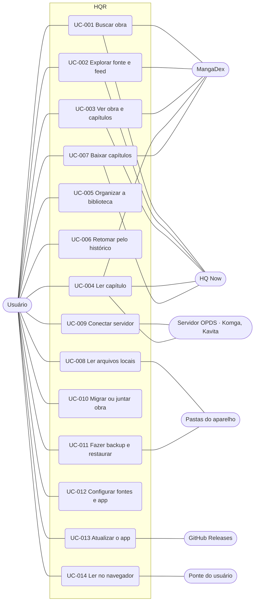

# Casos de uso: HQR

> Versão 1.0 · 2026-10-29 · Deriva de `docs/srs.md` · 14 casos de uso

## Diagrama

## Especificações

### UC-001 Buscar obra
- **Ator:** Usuário · **Secundários:** fontes ligadas
- **Fluxo principal:** 1. Usuário abre a busca e vê as recentes. 2. Digita. 3. Depois de 400 ms parado, o sistema consulta todas as fontes ligadas em paralelo. 4. Cada fonte mostra o seu grupo assim que responde, com o selo "Na biblioteca" quando cabe. 5. Usuário toca numa obra (UC-003) ou em "Ver mais" de uma fonte, que abre a busca dentro dela com filtros.
- **Alternativos:** 5a. Busca numa fonte com filtros e opção de salvar a busca (RF-22, RF-24).
- **Exceções:** 4a. Fonte com erro ou lenta: só o grupo dela mostra o erro, com "Tentar de novo". 4b. Nenhum resultado: estado vazio com atalho para Fontes.
- **Rastreia:** RF-01, RF-03, RF-04, RF-05, RF-12, RF-22 a RF-28, RNF-05, RF-86, RF-87, RF-99 a RF-104, RF-106.

### UC-002 Explorar fonte e feed
- **Ator:** Usuário · **Secundários:** MangaDex, HQ Now
- **Fluxo principal:** 1. Usuário abre Explorar e escolhe uma fonte. 2. O sistema mostra Populares e Recentes, com carregamento contínuo. 3. Usuário abre uma obra (UC-003).
- **Alternativos:** 1a. Usuário abre o Feed: o sistema mostra o que guardou de cada origem, com a idade, e pede de novo as de mais de 30 minutos; as obras ficam numa lista só, por data. 1b. Usuário monta o feed escolhendo recentes de fontes e buscas salvas. 1c. Usuário favorita uma fonte pela estrela: os recentes dela entram no feed e ela sobe para "Favoritas".
- **Exceções:** 2a. Fonte fora do ar: erro com "Tentar de novo" e "Abrir no navegador".
- **Rastreia:** RF-01, RF-05, RF-12, RF-21, RF-24, RF-25, RF-26, RF-86, RF-115, RF-116.

### UC-003 Ver obra e capítulos
- **Ator:** Usuário · **Secundário:** fonte da obra
- **Fluxo principal:** 1. O sistema mostra na hora o que já tem (biblioteca ou resultado) e pede detalhes e capítulos à fonte ao mesmo tempo; obra atualizada há menos de 6 horas não é pedida. 2. Mostra capa, tags, sinopse e, quando chegam, os capítulos com grupo, data, estado e download; até lá, esqueletos e "Buscando no <fonte>…". 3. O botão principal diz "Ler cap. N", "Continuar · cap. N" ou "Ler de novo". 4. Usuário lê (UC-004), põe na biblioteca (UC-005), baixa (UC-007) ou marca capítulos.
- **Alternativos:** 2a. Filtros e ordem dos capítulos; esconder grupos. 2b. Capítulo externo do MangaDex abre no navegador. 4a. Puxar para atualizar.
- **Exceções:** 1a. Fonte falha: mostra o que já tinha; a falha da lista fica na lista, com "Tentar novamente" e "Abrir no navegador". 1b. Obra de fonte que não existe neste sabor: "Fonte indisponível", com migração (UC-010).
- **Rastreia:** RF-07, RF-11, RF-29 a RF-35, RF-73, RNF-17, RF-90, RF-92, RF-117.

### UC-004 Ler capítulo
- **Ator:** Usuário · **Secundários:** fonte da obra, servidor de imagens
- **Pré-condição:** capítulo baixado, local ou com internet.
- **Fluxo principal:** 1. O sistema escolhe o modo (o da obra, o sugerido ou o padrão). 2. Pega a lista de páginas (baixado, arquivo, OPDS-PSE ou fonte; no MangaDex, o servidor at-home). 3. Abre na página salva e pré-carrega as próximas. 4. Usuário vira as páginas por toque, gesto, tecla ou controle; a página é gravada a cada troca. 5. No fim, o capítulo fica lido e aparece a transição para o próximo, com aviso de lacuna.
- **Alternativos:** 4a. Menu: barra de páginas, capítulo anterior ou próximo, ajustes rápidos. 4b. Página dupla ou dividida em tela larga. 4c. Rolagem automática. 4d. Modo anônimo não grava nada.
- **Exceções:** 2a. Capítulo sem páginas: "Capítulo indisponível na fonte". 3a. Página com erro: "Tentar de novo" só nela. 3b. Servidor at-home expirado: pede outro sem interromper.
- **Rastreia:** RF-09, RF-36 a RF-51, RF-61, RF-65, RNF-02 a RNF-04, RNF-11, RF-88, RF-97, RF-98.

### UC-005 Organizar a biblioteca
- **Ator:** Usuário
- **Fluxo principal:** 1. Usuário põe a obra na biblioteca e escolhe categorias. 2. Na Biblioteca, navega por abas de categoria, com filtros, ordem, busca e exibição. 3. Seleciona várias para mover, marcar, baixar ou remover.
- **Alternativos:** 2a. Puxar para atualizar busca capítulos novos das obras online.
- **Exceções:** 3a. Remoção: "Desfazer" devolve tudo como estava.
- **Rastreia:** RF-52 a RF-58, RNF-06.

### UC-006 Retomar pelo histórico
- **Ator:** Usuário
- **Fluxo principal:** 1. Usuário abre o Histórico, agrupado por dia. 2. Toca numa leitura. 3. O leitor abre no capítulo e na página salvos (UC-004).
- **Alternativos:** 2a. Remove um item ou limpa tudo (com confirmação).
- **Rastreia:** RF-31, RF-59 a RF-61.

### UC-007 Baixar capítulos
- **Ator:** Usuário · **Secundário:** fonte da obra
- **Fluxo principal:** 1. Usuário escolhe o que baixar. 2. O sistema põe na fila e baixa em segundo plano, com notificação, respeitando o Wi-Fi e os limites da fonte. 3. Cada página é conferida e salva (pasta do app ou escolhida, opcionalmente em CBZ). 4. O capítulo aparece como baixado e passa a abrir sem internet.
- **Alternativos:** 2a. Pausar, retomar, cancelar, reordenar. 4a. Apagar depois de lido.
- **Exceções:** 2b. Sem Wi-Fi: "Esperando Wi-Fi". 2c. Pouco espaço: pausa com aviso. 2d. Falha de rede: retoma sem baixar de novo o que já está completo.
- **Rastreia:** RF-04, RF-62 a RF-68, RNF-21, RNF-22, RF-94, RNF-23 a RNF-28.

### UC-008 Ler arquivos locais
- **Ator:** Usuário · **Secundário:** pastas do aparelho
- **Fluxo principal:** 1. Usuário escolhe uma pasta. 2. O sistema lê subpastas e arquivos e monta obras e capítulos, usando `ComicInfo.xml` quando existir. 3. Usuário abre e lê (UC-004).
- **Alternativos:** 1a. Pasta de downloads da 0.0.5. 2a. Puxar para reler a pasta.
- **Exceções:** 2b. Arquivo corrompido ou formato não suportado: o item aparece com aviso e não abre.
- **Rastreia:** RF-13 a RF-16, RF-85, RF-93, RNF-26.

### UC-009 Conectar servidor
- **Ator:** Usuário · **Secundário:** servidor OPDS
- **Fluxo principal:** 1. Usuário informa nome, endereço e login. 2. O sistema testa a conexão. 3. Salva, com a senha no armazenamento seguro. 4. Usuário navega pelos catálogos, busca e lê por streaming de páginas.
- **Alternativos:** 4a. Komga ou Kavita recebem o progresso de leitura.
- **Exceções:** 2a. Endereço inalcançável, login recusado, certificado inválido ou resposta que não é OPDS, cada um com mensagem própria. 1a. Endereço `http`: aviso antes de salvar.
- **Rastreia:** RF-17 a RF-20, RNF-09, RF-95, RF-96.

### UC-010 Migrar ou juntar obra
- **Ator:** Usuário · **Secundárias:** fontes ligadas
- **Fluxo principal (migrar):** 1. Usuário escolhe "Migrar" e as fontes de destino. 2. O sistema busca o título nelas e mostra os candidatos. 3. Usuário confirma um. 4. O sistema leva categorias, capítulos lidos (pelo número) e histórico.
- **Fluxo alternativo (juntar):** 1. Usuário escolhe "Juntar" e as outras entradas da mesma obra. 2. Define a prioridade das fontes. 3. A obra passa a mostrar os capítulos de todas, sem repetir números.
- **Alternativos:** Migração em lote, com o resultado de cada obra. Desfazer a junção.
- **Exceções:** 2a. Nenhum candidato: a obra fica como está.
- **Rastreia:** RF-69 a RF-71.

### UC-011 Fazer backup e restaurar
- **Ator:** Usuário · **Secundário:** pastas do aparelho
- **Fluxo principal:** 1. Usuário cria o backup e escolhe onde salvar. 2. Em outro aparelho (Android ou iPhone), escolhe o arquivo. 3. O sistema confere a versão e soma ao que existe. 4. Mostra o resumo e as obras de fontes ausentes.
- **Alternativos:** 1a. Backup automático diário ou semanal.
- **Exceções:** 3a. Arquivo inválido ou de versão mais nova: mensagem e nada é alterado.
- **Rastreia:** RF-72 a RF-75, RF-89.

### UC-012 Configurar fontes e app
- **Ator:** Usuário
- **Fluxo principal:** 1. Na primeira abertura, o usuário escolhe os idiomas de conteúdo e vê o aviso. 2. Em Fontes, liga e desliga fontes e ajusta cada uma. 3. Em Ajustes, escolhe tema, idioma, padrões do leitor, downloads e cache. 4. No Sobre, vê créditos, licenças e política.
- **Rastreia:** RF-02, RF-03, RF-06, RF-08, RF-10, RF-76 a RF-81, RNF-10, RNF-14, RF-91, RNF-29, RF-105.

### UC-013 Atualizar o app
- **Ator:** Usuário · **Secundário:** GitHub Releases
- **Fluxo principal:** 1. Ao abrir (até uma vez por dia), o sistema confere a versão mais nova. 2. Havendo uma, mostra as novidades. 3. Usuário aceita; o APK é baixado e o instalador do sistema abre.
- **Alternativos:** 1a. Conferência manual nos Ajustes. 1b. A 0.0.5 encontra a 1.0 e a instala como app separado.
- **Exceções:** 1c. Sem internet ou GitHub fora: nada aparece.
- **Rastreia:** RF-82 a RF-84.

### UC-014 Ler no navegador
- **Ator:** Usuário · **Secundário:** Ponte do usuário
- **Fluxo principal:** 1. Usuário abre o endereço do app no navegador e, se quiser, instala como PWA. 2. Em Ajustes › Ponte, informa endereço e token da ponte que publicou e toca "Testar". 3. Explora e busca nas fontes online, que passam pela ponte. 4. Lê com teclado e mouse; o endereço guarda obra, capítulo e página.
- **Alternativos:** 2a. Sem ponte: importa CBZ, CB7 ou PDF arrastando para a janela, ou conecta um servidor com a origem liberada.
- **Exceções:** 2b. Token recusado ou ponte fora do ar: mensagem no teste e fontes online com "Precisa da ponte". 3a. Fonte com verificação do Cloudflare: aparece desativada com o motivo.
- **Rastreia:** RF-107 a RF-114, RNF-30 a RNF-33.
