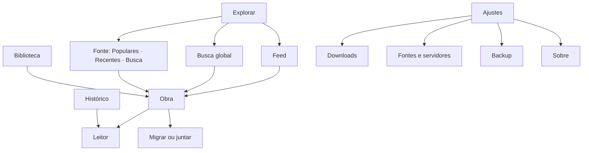
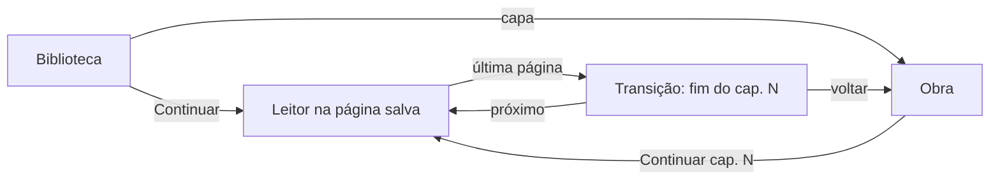

# Fundamentos de UX: HQR

> Versão 1.0 · 2026-10-29 · Entradas: `docs/srs.md`, `docs/architecture.md`, `docs/use-cases.md`, `docs/benchmark.md` · Valores visuais só em `docs/design.md` e `docs/tokens.json`

## 1. Princípios

1. **A página da obra é sagrada.** No leitor, nada de textura, cor ou enfeite sobre a arte; o "jeito de HQ" fica no resto do app.
2. **Material e HIG primeiro, HQ por cima.** Componentes do sistema, sem trocar padrões de lista e navegação; a identidade vem de forma (corte de quadro), retícula, balão e ilustração.
3. **Um toque para voltar a ler.** "Continuar" na Biblioteca, na obra e no Histórico.
4. **Tocar na obra abre a obra**, nunca o último capítulo direto (lição do MANGA Plus).
5. **Nunca perder o que o usuário fez:** toda remoção tem "Desfazer"; falha de fonte não apaga nada (RNF-17).
6. **Movimento explica, não enfeita:** abaixo de 400 ms, pulável, e com "reduzir movimento" vira esmaecimento.

## 2. Pessoas

As classes P1 a P4 do SRS §2.2. Superfícies: **Android (celular, tablet, dobrável)** no 1.0; **web** (navegador do computador e PWA, marco Web) com as mesmas telas Compose; **iPhone e iPad** depois (C-09), com os mesmos SCR em SwiftUI e HIG.

## 3. Arquitetura de informação

Quatro destinos na barra (celular), no trilho (tablet) ou na gaveta fixa (web e janelas ≥ 1200 dp), por `NavigationSuiteScaffold`; `TabView` e barra lateral no iOS:

| Destino | Por quê |
| :-- | :-- |
| Biblioteca | Abre o app aqui: "Continuar" e as séries acompanhadas (UC-005, UC-006) |
| Explorar | Feed, fontes e a busca global num lugar; o Feed é a primeira aba porque mostra o que saiu (UC-001, UC-002) |
| Histórico | Retomar qualquer leitura (UC-006) |
| Ajustes | Downloads, fontes, servidores, backup, leitor, aparência, Sobre (UC-007, UC-009, UC-011, UC-012) |

Downloads também tem atalho no topo da Biblioteca, com selo enquanto a fila roda. A busca global abre pelo campo no topo de Explorar e pelo ícone na Biblioteca.

## 4. Inventário de telas

| ID | Tela | Requisitos | UC |
| :-- | :-- | :-- | :-- |
| SCR-ONB-001 | Primeira abertura: idiomas de conteúdo e aviso | RF-81 | UC-012 |
| SCR-LIB-001 | Biblioteca: abas de categoria, grade, "Continuar", seleção | RF-52 a RF-58 | UC-005 |
| SCR-LIB-002 | Filtrar, ordenar e exibir (folha) | RF-54, RF-55 | UC-005 |
| SCR-LIB-003 | Categorias: criar, renomear, ordenar | RF-53 | UC-005 |
| SCR-EXP-001 | Explorar: Feed e lista de fontes | RF-03, RF-25 | UC-002 |
| SCR-EXP-002 | Fonte: Populares, Recentes, busca com filtros, buscas salvas | RF-21, RF-22, RF-24 | UC-001, UC-002 |
| SCR-EXP-003 | Filtros da fonte (folha) | RF-22, RF-24 | UC-001 |
| SCR-EXP-004 | Montar o feed | RF-25 | UC-002 |
| SCR-SRCH-001 | Busca global agrupada por fonte | RF-23, RF-26 a RF-28 | UC-001 |
| SCR-OBR-001 | Obra: capa, dados, "Continuar", capítulos, cor da capa | RF-29 a RF-35, RF-07, RF-11, RF-12, RF-92, RF-93, RF-98 | UC-003 |
| SCR-OBR-002 | Migrar ou juntar | RF-69 a RF-71 | UC-010 |
| SCR-RDR-001 | Leitor: páginas, menu, barra de páginas, quadro a quadro | RF-36 a RF-41, RF-43 a RF-51, RF-97, RF-98, RF-113 | UC-004 |
| SCR-RDR-002 | Ajustes do leitor (folha) | RF-36 a RF-39, RF-44 a RF-50, RF-98 | UC-004 |
| SCR-RDR-003 | Transição entre capítulos | RF-42, RF-98 | UC-004 |
| SCR-HIS-001 | Histórico por dia | RF-59 a RF-61 | UC-006 |
| SCR-DL-001 | Downloads: fila e baixados | RF-62 a RF-68, RF-94 | UC-007 |
| SCR-SRC-001 | Fontes, pastas e servidores | RF-03, RF-13 a RF-16, RF-17, RF-85, RF-99 a RF-105, RF-114 | UC-008, UC-009, UC-012, UC-014 |
| SCR-SRV-001 | Adicionar servidor | RF-17 a RF-19, RF-95, RF-96, RF-111 | UC-009 |
| SCR-SRV-002 | Catálogo do servidor: pastas, busca, volumes | RF-18, RF-20 | UC-009 |
| SCR-SRC-002 | Ajustes da fonte (idiomas, qualidade; conteúdo sugestivo após 18+) | RF-06, RF-08, RF-10 | UC-012 |
| SCR-SET-001 | Ajustes (inclui ligar ou desligar a cor da capa) | RF-76, RF-77, RF-80, RF-98 | UC-012 |
| SCR-SET-002 | Backup e restauração | RF-72 a RF-75, RF-89 | UC-011 |
| SCR-SET-003 | Sobre, créditos e licenças | RF-78, RF-79 | UC-012 |
| SCR-SET-004 | Atualização do app | RF-82, RF-84 | UC-013 |
| SCR-STA-001 | Estados: carregando, vazio, erro, sem conexão, verificação do Cloudflare | RF-86, RF-87, RF-05, RF-88, RF-106 | todos |
| SCR-WEB-001 | Ponte: endereço, token, testar, passo a passo (web) | RF-108, RF-109 | UC-014 |
| SCR-WEB-002 | Importar arquivos: arrastar e soltar, cota usada e livre (web) | RF-110 | UC-014 |
| SCR-WEB-003 | Atalhos do teclado (web) | RF-112 | UC-014 |
| SCR-WEB-004 | Navegador sem suporte (web) | RF-107, RF-114, RNF-31 | UC-014 |

**Variações por superfície.** Cada SCR acima existe em todas as superfícies, salvo o que diz esta tabela.

| Superfície | Diferenças |
| :-- | :-- |
| Android tablet e dobrável | Lista-detalhe (Biblioteca + Obra, Ajustes + página); leitor com painel lateral |
| Web | Mesmas telas do Android em largura expandida ou maior; SCR-WEB-001 a 004 só aqui; sem SCR-SET-004 (atualização) e sem a verificação do Cloudflare de SCR-STA-001; Fontes (SCR-SRC-001) mostra "Precisa da ponte" e "Só no app do celular"; Downloads avisa que roda só com a aba aberta |
| iPhone | Mesmos SCR com controles do iOS: `TabView`, listas agrupadas, folhas e menus do sistema |
| iPad | `NavigationSplitView` com barra lateral (destinos), lista e detalhe; leitor em duas páginas em paisagem |

## 5. Fluxos principais

| Fluxo | Caminho | Toques até ler |
| :-- | :-- | :-- |
| Retomar (UC-006) | Biblioteca › Continuar | 1 |
| Achar algo novo (UC-001) | Explorar › campo de busca › obra › Ler | 4 |
| Ler arquivo próprio (UC-008) | Ajustes › Fontes › Arquivos locais › escolher pasta (uma vez) › obra › Ler | 2 depois da pasta |
| Baixar para a viagem (UC-007) | Obra › Baixar › próximos 5 | 3 |

## 6. Telas por tamanho

| Classe de largura | Navegação | Biblioteca | Obra | Leitor |
| :-- | :-- | :-- | :-- | :-- |
| Compact < 600 dp | Barra inferior | 3 colunas | Uma coluna: capa, dados, capítulos | Uma página |
| Medium 600–839 dp | Trilho | 4–5 colunas | Capa e dados à esquerda, capítulos à direita | Uma página; duas em paisagem |
| Expanded 840–1199 dp | Trilho | 6+ colunas | Lista-detalhe: Biblioteca à esquerda, Obra à direita | Duas páginas; painel lateral de ajustes de 360 dp |
| Large 1200–1599 dp (web, tablet grande) | Gaveta fixa | 7–8 colunas | Lista-detalhe com a obra em painel de 480 dp | Duas páginas; painel lateral de 360 dp |
| Extra-large ≥ 1600 dp (web) | Gaveta fixa | Conteúdo em largura máxima de 1600 dp, centralizado | Como Large, com sinopse e capítulos lado a lado | Duas páginas no centro; margens pretas |
| iPad (1194×834 pt em paisagem) | Barra lateral | 6 colunas | Lista e detalhe no `NavigationSplitView` | Duas páginas em paisagem |

Dobrável: postura livro = duas páginas, nada sobre a dobra; postura mesa = página em cima, controles embaixo. Na web, uma janela estreita (< 600 dp) usa o layout de celular.

## 7. O leitor em detalhe

- **Cromo zero:** ao abrir, só a página; um toque no centro mostra a barra superior (voltar, obra, capítulo, ⋮) e a barra flutuante inferior (barra de páginas "X de Y", capítulo anterior e próximo, ajustes). Na leitura da direita para a esquerda, a barra de páginas e os botões de capítulo também se invertem.
- **Primeiro uso:** um balão de dica mostra as zonas de toque do esquema escolhido por 3 s (RF-38), uma vez por modo.
- **Transição (SCR-RDR-003):** página própria no fluxo: "Fim do cap. 10", miniatura e título do próximo, selo "Baixado" ou "Online", aviso de lacuna; arrastar continua, "Voltar à obra" sai.
- **Leitura guiada por quadros (RF-97, Could, experimental):** o botão "Quadro a quadro" do menu entra; a câmera vai de quadro em quadro, detectados no aparelho; sair volta à página inteira.

## 8. Estados (RF-86, RF-87)

| Estado | Como aparece |
| :-- | :-- |
| Carregando | Esqueletos com a forma final (capas com o corte de quadro); `LoadingIndicator` do M3 em cargas longas, com a onomatopeia da vez só acima de 1,5 s |
| Vazio | Ilustração em quadro de HQ, título em balão, uma frase e uma ação. Biblioteca: "Sua estante está vazia" + "Explorar"; Downloads: "Nada baixado" + "Ver biblioteca"; Busca: "Nada para 'x'" + "Ver fontes" |
| Erro de fonte | No grupo ou na tela da fonte: ícone, causa em uma frase, "Tentar de novo" e "Abrir no navegador" |
| Sem conexão | Faixa discreta no topo "Sem conexão · mostrando o que está no aparelho"; ações de rede desligadas |
| Fonte indisponível | Obra com selo "Fonte indisponível" e ação "Migrar" |
| Filtrado | Há obras, mas filtros ou busca escondem todas: "Nenhuma obra com esses filtros" + "Limpar filtros" |
| Removido | Snackbar longa com "Desfazer" (biblioteca, categoria, histórico); desfazer devolve data de entrada e categorias |

## 9. Acessibilidade (RNF-11, RNF-12)

- Leitor de tela: capas anunciam "Título, 3 não lidos, baixado"; página anuncia "Página 4 de 22"; onomatopeias e ilustrações são decorativas (escondidas) e o estado vai em texto.
- Fonte a 200%: chips e selos crescem; títulos de capa quebram em até 2 linhas.
- Alvos de 48 dp, foco visível por teclado, leitor por setas, espaço e controle (RF-47).
- "Reduzir movimento": transições viram esmaecimento de 150 ms; loading sem onomatopeia animada.

## 10. Telas no iPhone e no iPad (depois)

Mesmos SCR; `TabView` com os quatro destinos no iPhone, `NavigationSplitView` no iPad; controles e materiais do iOS; corte de quadro, retícula e balões adaptados ao SF Symbols e ao vidro do sistema, sem copiar formas do M3.

## 11. Web

- **Mesmas telas, outro meio:** Compose para Web desenha o mesmo Material do Android; nada de imitar site. O endereço acompanha a tela (`/obra/<id>`, `/ler/<capítulo>?p=8`).
- **Mouse:** todo item clicável tem hover (camada de estado do M3) e menu de contexto com as ações do toque longo; capas mostram "Continuar" no hover.
- **Teclado:** foco visível em tudo; "/" abre a busca; no leitor, setas, espaço, F e "?" (SCR-WEB-003).
- **Ponte:** fontes online sem ponte ficam visíveis com o selo "Precisa da ponte" e levam a SCR-WEB-001; nada some sem explicação.
- **Arquivos:** soltar CBZ, CB7 ou PDF em qualquer tela abre a importação (SCR-WEB-002); o espaço do navegador aparece em Ajustes e em Downloads.
